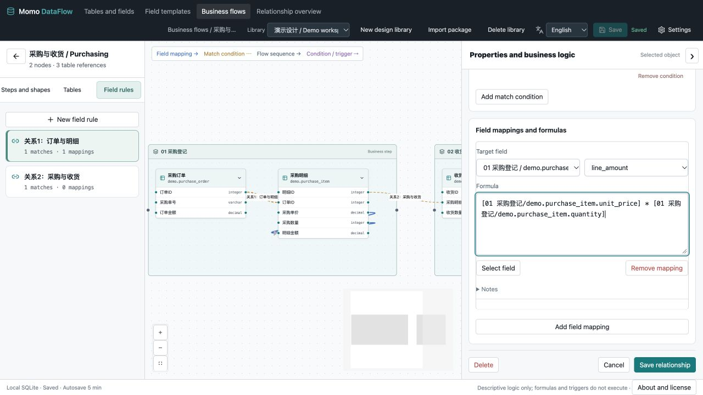
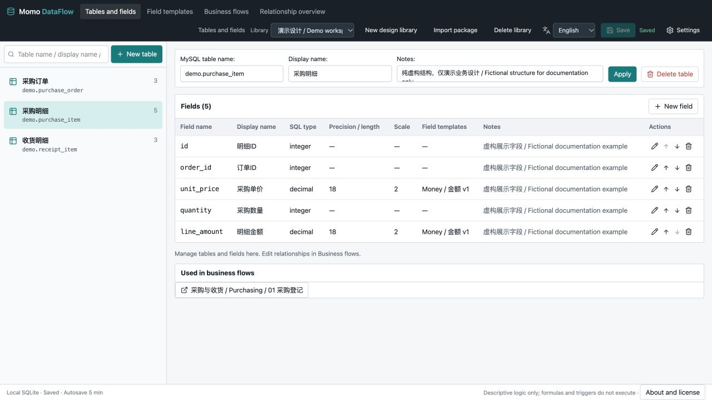
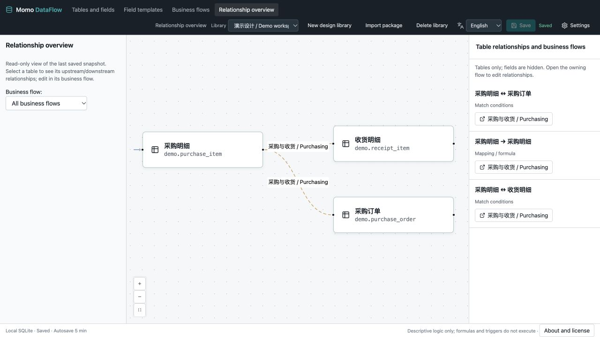
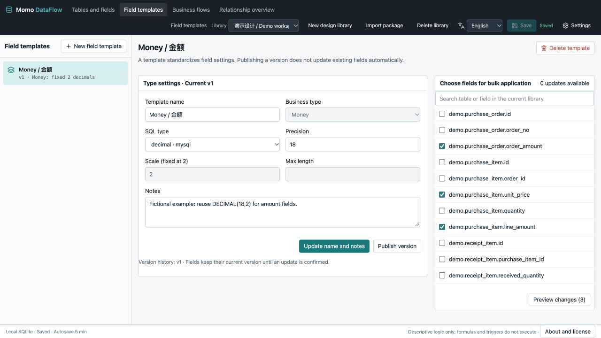

# Momo DataFlow

[简体中文](README.md) · **English**

**A business-flow and data-relationship design workbench, derived from [StackRender](https://github.com/stackrender/stackrender).**

Document which tables participate in each business step, where fields come from, and how conditions and mappings connect them. This is an independently maintained derivative, not an official StackRender release.

> **v0.1.0-beta.4 · Preview.** The interface supports Chinese and English. Formulas and trigger arrows describe logic; they do not execute calculations or business operations.

## Why this project exists

When documenting a business, process diagrams, table schemas and field descriptions often live in separate documents or tools. It is easy to lose track of the tables and fields involved in a process, or to inspect a field without understanding the business step that uses it. This project brings those pieces into one workbench so they can be reviewed, connected and discussed together.

The current UI still has awkward layouts, editing operations and interaction details. There is plenty to improve through real use. By opening this project, I hope other users and developers can build on the existing work, improve the interface and editing experience, and make the connection between business processes and data structures clearer. Feedback, design discussions and [contributions](CONTRIBUTING.md) are welcome.

## Screenshots

These are real screenshots of the local app using fictional design metadata. UI language does not translate user-authored names or notes. The importable [showcase package](docs/usage/examples/showcase-purchase.stackrender.json) supplies the tables and equality conditions; templates and formulas shown here are added through the interface.

**Business flow and field formula — English interface**



| Tables and fields | Read-only relationship overview |
| --- | --- |
|  |  |

**Reusable field templates**



[Chinese interface screenshot](docs/images/flow-zh.jpg) · [Screenshot details](docs/images/README.md)

## What comes from StackRender

StackRender provides an open-source ERD/schema-design foundation. This derivative retains its React/Vite foundation, table and field models, SQL-type metadata and browser SQLite infrastructure. Credit and original notices are preserved in [NOTICE](NOTICE.md), with an [unchanged upstream README snapshot](docs/upstream/README.md).

Momo DataFlow adds a business-focused workbench: reusable field templates, business steps, flow-local table references, field conditions, descriptive mappings/formulas and a read-only overview. The original ERD window is not exposed; old ERD URLs redirect to table management. Upstream SQL import/export, cloud AI and other upstream workflows are not advertised as verified features of this edition.

## Features

- **Tables and fields:** technical names, display names, notes, SQL-type settings and constraints, managed in table form.
- **Reusable field templates:** for example, money as `DECIMAL(18,2)`. Preview and explicitly confirm updates before applying a template version to existing fields.
- **Business flow canvas:** start/end nodes, business steps, decisions and labeled/conditional connections. Reference only the tables involved in each step; reuse a table definition across steps.
- **Conditions and mappings:** match-all/match-any conditions, direct assignments, arithmetic and parentheses. A connection limits field choices to its table references. New relationships receive sequential names.
- **Formula input:** drag expanded table fields into a formula, use `⌘`-click on Mac / Ctrl-click on other platforms, or choose a table and field in two columns. Type operators yourself.
- **Read-only overview:** automatic table layout and business-flow filtering. Edit relationships in their owning flow.
- **Local workflow:** draggable JSON import with preview, confirmed field/library deletion, adjustable/collapsible properties panel and manual/autosave (every five minutes by default).
- **Chinese / English interface:** change the language in the header. The preference stays in this browser; existing table names, field labels, notes, formulas and stable IDs remain unchanged.

## Run locally

Requirements: Node.js `^20.19.0 || >=22.12.0`, npm, and a modern Chromium browser with SQLite/WASM support. This preview was checked with **Node.js 25.8.0 / npm 11.11.0 on macOS**; other platforms/versions were not comprehensively tested.

```sh
git clone https://github.com/Momostar33/momo-dataflow.git
cd momo-dataflow
npm ci
npm run dev
```

Open **http://127.0.0.1:4327**. Choose **English** in the header if needed. Click **New design library** to create a MySQL-design catalog, then add tables, fields and flows. No MySQL server or database credentials are required. Alternatively, use **Import package** with a [fictional example](docs/usage/examples/design-package-v1.example.json).

To preview a production build:

```sh
npm run build
npm run preview
```

Development and preview use the same port; stop one before starting the other. This release provides source code and a Web build, not a desktop installer or hosted service.

## Saving, deletion and JSON

The app stores design metadata in **this browser profile and site origin**, using `momo-dataflow.sqlite`. Different hosts/ports or browser profiles do not share designs. Importing JSON does not create a project folder on disk.

**Apply / Save relationship** first updates the workspace draft. The header **Save**, or a successful autosave, writes that draft to SQLite. Check for **Saved** before closing. Clearing site data deletes the browser's designs.

Deleting a field asks for confirmation and removes dependent relationships and entire affected rules, including their other conditions/mappings. It changes the draft until saved; discarding the whole unsaved draft can restore it before then. Confirming **Delete library** immediately persists deletion of that library, while keeping other libraries, shared templates and source JSON files. There is no trash.

Source JSON and browser data do **not** synchronize. Package v1 appends a new library, never merges or overwrites one. Duplicate names or entity IDs are rejected. It imports tables, fields, ordinary steps, table references and equality conditions; it does **not** import formula mappings or decision/trigger transitions. Those can be edited in the UI. Files are limited to 30 MiB. Arbitrary draw.io/DrawDB/other JSON files are not automatically converted. Complete export/round-trip and version merging are not implemented; Git-tracked JSON is not a live backup of browser edits.

## For Codex and other agents

Read the repository [AGENTS.md](AGENTS.md), then the [agent guide](docs/usage/AGENT_GUIDE.md), [JSON format](docs/usage/DESIGN_PACKAGE_JSON_EN.md) and [task template](docs/usage/templates/design-package-task.md). Use the [JSON Schema](docs/usage/design-package-v1.schema.json) and existing examples rather than inventing a format.

```sh
npm run validate:design -- /absolute/path/to/design.stackrender.json
```

This uses the native importer against an in-memory workspace with the MySQL type catalog. It does not import into the browser, write source JSON, connect to a business database or execute an AI agent. Passing it does not prove compatibility with a nonempty browser workspace or confirm business correctness.

## Development and scope

```sh
npm test
npm run typecheck
npm run build
```

Type checking covers the public application entry and its dependencies, not unused inherited modules. Results and remaining bundle/deprecation warnings are recorded in [validation](docs/VALIDATION.md). Zero known dependency advisories is not a full security audit or business acceptance.

The app does not evaluate Excel functions, execute formulas/workflow jobs, connect to business databases, run migrations, offer cloud synchronization or provide real-time collaboration.

- [English user guide](docs/usage/USER_GUIDE_EN.md)
- [English JSON guide](docs/usage/DESIGN_PACKAGE_JSON_EN.md)
- [Release notes](CHANGELOG.md)
- [Contributing / reporting issues](CONTRIBUTING.md)

## License and attribution

Thanks to StackRender's original authors and contributors. Momo DataFlow is an independent derivative distributed under **GNU AGPL v3**, without warranty. You may copy, modify and redistribute it under that license. Original notices and the license text are retained; see [LICENSE](LICENSE) and [NOTICE](NOTICE.md).

If you distribute a build or host a modified version for others, keep the corresponding source for that version available as required by the license, and retain the visible source/license links. Screenshots and an upstream link do not replace corresponding source.
