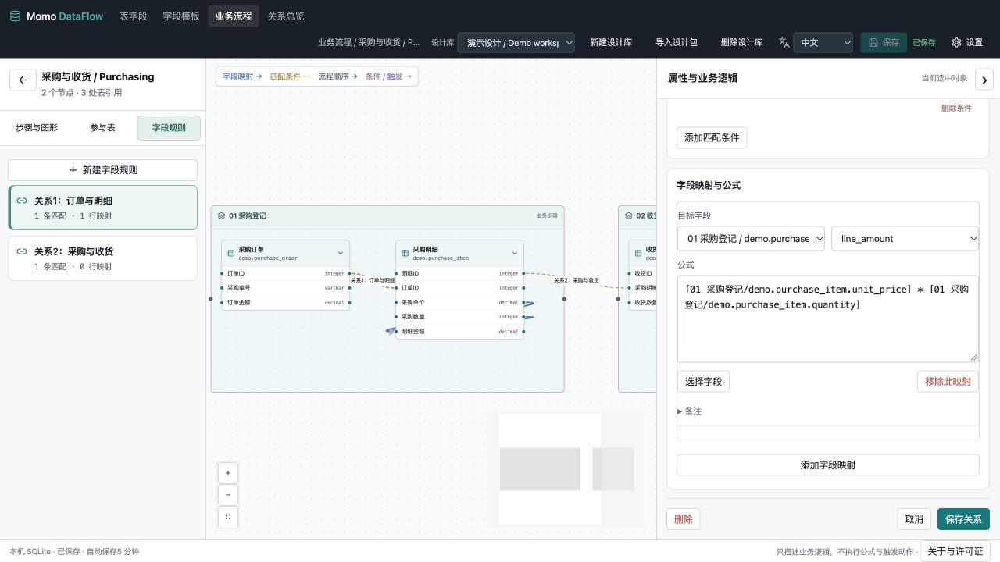
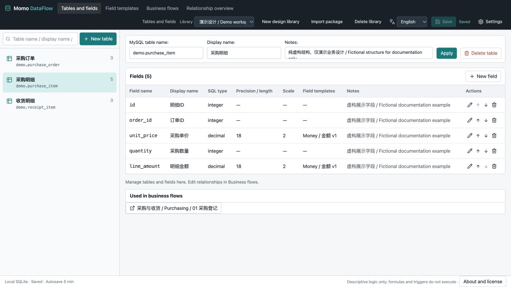
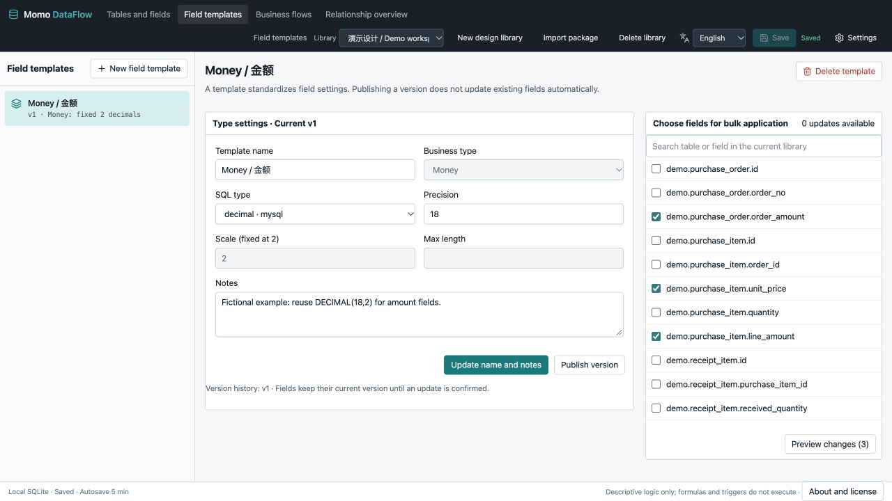
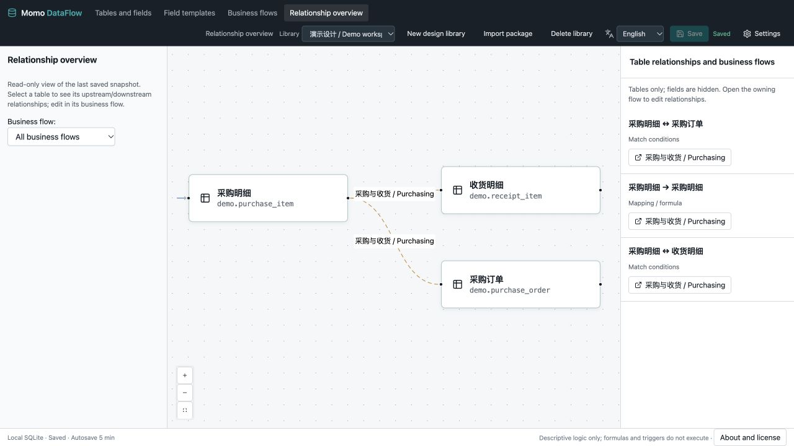

# Momo DataFlow

**简体中文** · [English](README.en.md)

**基于 [StackRender](https://github.com/stackrender/stackrender) 二次开发的业务流程与数据关系设计工具。**

把业务步骤、参与的表、字段条件和映射公式放在同一个工作台里，帮助梳理“哪些表参与哪个业务、字段从哪里来、关系怎样传递”。

A local-first business flow and data relationship workbench, derived from StackRender. Independently maintained; not an official StackRender release.

> **v0.1.0-beta.4 · 预览版**。关系、公式和触发箭头用于设计说明，不执行计算或业务任务。

## 界面截图

截图来自本地真实界面，使用完全虚构的设计。中英文切换只改变界面，不翻译用户填写的表名、字段说明和业务备注。



[查看英文界面](docs/images/flow-en.jpg)

| 表与字段管理 | 字段模板 | 只读关系总览 |
| --- | --- | --- |
|  |  |  |

[截图说明](docs/images/README.md) · [可导入的虚构展示包](docs/usage/examples/showcase-purchase.stackrender.json)。包内初始只有表、普通步骤和等值条件；截图里的模板、公式通过界面添加，不能把它们误认为 v1 已支持导入。

## 与原版 StackRender 的关系

StackRender 原版主要提供数据库结构图（ERD）、表与字段设计、SQL DDL 导入导出等能力。感谢原作者与贡献者提供的开源基础。本版复用其 React/Vite 技术基础、表字段模型、SQL 类型元数据与浏览器 SQLite 存储能力，在此之上增加面向业务流程的设计工作台。

| 范围 | Momo DataFlow 本版 |
| --- | --- |
| 表、字段、类型和结构元数据 | 复用基础，增加说明名、备注和可复用字段模板 |
| 业务流程 | 增加流程、步骤、表引用、字段匹配和映射说明 |
| 关系查看 | 增加按业务查看和自动布局的只读关系总览 |
| 原版 ERD 窗口 | 不提供入口；旧地址跳转到表字段管理 |
| 原版 SQL 导入导出、云端 AI 等 | 本版未开放对应使用流程，不作为本版功能承诺 |

原版说明快照与来源见 [StackRender 来源说明](docs/upstream/README.md)，完整修改说明见 [NOTICE](NOTICE.md)。原许可证、版权声明及源码中的原作者注释予以保留。

## 可以做什么

- **表与字段管理**：技术表名、自定义说明名、备注、字段类型与约束；采用表格界面维护。
- **字段模板**：如金额 `DECIMAL(18,2)`，创建字段时继承模板；模板变更先预览，再确认批量更新已有字段。
- **业务流程画布**：按采购、收货等业务分别绘制，支持开始、结束、普通步骤、判断节点和带条件的连线；每个步骤只拉入参与的表。
- **字段关系与映射**：多条件匹配、直接赋值、四则运算和括号。连接两张表后，字段选项限定在该连接范围；新连线和规则自动命名为“关系1、关系2……”且可改名。
- **便捷输入**：把展开表中的字段拖进公式，或在 Mac 上按住 `⌘` 点击插入；也可用“表／字段”两列选择器，自己输入运算符号。
- **只读关系总览**：自动布局表之间的关系，查看关联业务模块；修改回到具体业务流程。
- **工作台操作**：右侧面板可调宽、收起；设计包可拖入窗口预览后导入；确认后删除字段或整个设计库。
- **中英文界面**：顶部选择中文或 English，偏好保存在当前浏览器；切换语言保留已有设计与正在编辑的内容。
- **本地保存**：手动保存，默认每 5 分钟自动保存，可设置间隔。

删除字段前会提示影响；确认后同时移除依赖该字段的关系或整条业务规则（包含该规则的其他条件和映射），避免残留错误引用。删除设计库会清理其表、字段和流程等内容，保留其他设计库及共享模板。删除字段先修改草稿，保存前可丢弃整份未保存草稿；删除设计库在确认后立即写入本地数据库。均不提供回收站，请先确认影响范围。

## 本地运行

需要 Node.js（20.x 须为 20.19 及以上，或使用 22.12 及以上版本；参见 [Vite 7 要求](https://v7.vite.dev/guide/migration#node-js-support)）、npm 和支持浏览器 SQLite/WASM 的现代 Chromium 浏览器。本次验证环境为 **Node.js 25.8.0 / npm 11.11.0**；其他 Node 版本未在本次发布中验证。

```sh
git clone https://github.com/Momostar33/momo-dataflow.git
cd momo-dataflow
npm ci
npm run dev
```

打开 **http://127.0.0.1:4327**。顶部可切换 **中文 / English**，首次默认中文。首次使用点击“新建设计库”，再创建表、字段和业务流程；也可通过“导入设计包”导入 [虚构示例](docs/usage/examples/design-package-v1.example.json)。当前新库采用 MySQL 设计类型，不需要真实 MySQL 服务或数据库账号。

查看生产构建：

```sh
npm run build
npm run preview
```

开发服务与预览服务使用同一端口，先停止前一个进程再启动另一个。当前交付源码和 Web 构建，不含桌面安装包或托管服务。

## 数据保存与 JSON

设计保存在**当前浏览器个人资料、当前站点地址**的 SQLite 中，数据库名为 `momo-dataflow.sqlite`。导入一个 JSON 不会在电脑上创建对应项目文件夹。请固定浏览器与访问地址；`localhost`、`127.0.0.1` 或不同端口属于不同来源，数据不会自动互通。右侧“保存关系”或表单“应用”先把编辑内容加入工作区草稿；点击顶部“保存”，或等待自动保存成功，才写入 SQLite。关闭本地服务前确认状态为“已保存”。清除站点数据会清除设计。

源 JSON 与浏览器数据**不自动同步**，界面编辑不会回写原文件。设计包 v1 仅追加新设计库，不覆盖或合并已有库；同名或实体 ID 冲突会拒绝导入。当前还没有完整设计包导出、往返同步或版本合并功能，Git 里的 JSON 不是浏览器数据的实时备份。

v1 支持表、字段、普通步骤、表引用和字段等值条件；**尚不支持导入公式映射和分支／触发线**，这些可在界面中编辑；上游 draw.io、DrawDB 或其他 JSON 不能只改扩展名就直接导入。单个设计包上限为 30 MiB。支持情况与示例见 [JSON 格式说明](docs/usage/DESIGN_PACKAGE_JSON.md)。

## 功能边界

- 公式、连线与触发只记录逻辑；不执行公式，不支持 Excel 函数求值。
- 不连接真实业务数据库，不执行 SQL 迁移、业务 API 或自动编程任务。
- 当前不提供账号体系、云同步或多人实时协作。
- 请勿在公开示例、Issue 或截图里提交密码、Token、真实业务数据和浏览器数据库。

## 给 Codex 等智能体使用

仓库 [AGENTS.md](AGENTS.md) 指向 [智能体说明](docs/usage/AGENT_GUIDE.md)、[结构 Schema](docs/usage/design-package-v1.schema.json) 和 [任务模板](docs/usage/templates/design-package-task.md)。先读取业务项目的确认资料和用户修改，再参照虚构示例整理 JSON；未知业务规则不能靠模型猜测。

```sh
npm run validate:design -- /absolute/path/to/design.stackrender.json
```

该命令复用原生导入器，在内存中校验结构和引用，不写浏览器 SQLite、不修改源 JSON、不执行模型或业务任务。通过校验不等于导入到现有工作区，也不等于业务确认；已有工作区仍可能存在名称/ID 冲突。

## 开发与验证

```sh
npm test
npm run typecheck
npm run build
```

`typecheck` 检查公开版应用入口及其依赖图；未被入口引用的上游遗留模块不在此检查范围。测试和构建结果、已知限制见 [验证记录](docs/VALIDATION.md)。本次锁文件的 `npm audit` 为 0 项已知告警；这是当前依赖公告检查结果，不等于完整安全审计。自动测试不代替你的实际业务验收。

- [使用说明](docs/usage/USER_GUIDE.md)
- [设计包 JSON 格式](docs/usage/DESIGN_PACKAGE_JSON.md)
- [更新记录](CHANGELOG.md)
- [问题反馈与贡献](CONTRIBUTING.md)

## 许可证与致谢

基于 [StackRender](https://github.com/stackrender/stackrender) 二次开发，感谢 StackRender 原作者及全部贡献者。本项目为独立衍生版本，与原项目不存在官方隶属关系。

沿用 **GNU Affero General Public License v3（AGPLv3）**，保留原许可全文与版权声明，不附带任何担保。你可以依据该许可证复制、修改和再分发。详见 [LICENSE](LICENSE) 和 [NOTICE](NOTICE.md)。

发布构建或向他人托管修改版时，须按许可证要求提供对应版本源码，并保留可见的源码/许可入口；截图和原项目链接不能代替对应源码。
